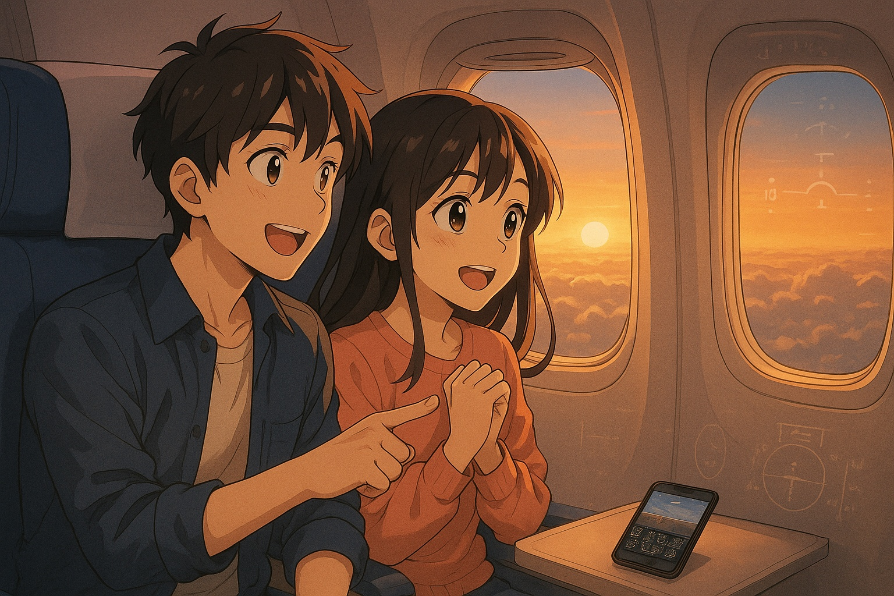

This is the first part of a series where I'll be sharing my journey toward earning a **Private Pilot License (PPL)**. Unlike many who dreamed of being pilots since childhood, my story is a little different. Aviation always fascinated me, but for a long time I actually **hated heights, and flying** along with them.

My journey with airplanes began as a passenger. Over the years, I've flown on everything from short-haul workhorses like the **Airbus A320** and **Boeing 737**, to modern upgrades like the **A320neo**, and even wide-bodies such as the **A330** and the double-deck **A380**. One aircraft still on my wishlist, though, is the **Boeing 777**.

At home, I spent countless hours on **Flight Simulator**, practicing takeoffs, approaches, and landings. Even during long trips, I'd pass the time with **mobile flight simulators** on my phone. On a screen, flying was easy. Being up high for real was another story.

## The surprise skydive

What changed that was my fiancée. She took me on a **surprise skydive**.

After that jump, the fear was gone. I started to actually enjoy being up high and looking out at the sky, instead of dreading it.

## Deciding on flight school

That's what made me decide to go to **flight school**. My fiancée isn't training herself, but she has supported me through this decision from the start.

After a few years of success in **trading**, building **businesses**, and shifting into **investing**, I reached a point where I could finally pursue passions outside of work. And since I've always been curious and love learning new skills, flying became the perfect fit.

For years, I thought sims would be as close as I'd ever get to a cockpit. Now I'm taking the leap into actual **flight training**. I'm glad I can do this **without worrying about financial limitations**, and fully focus on learning and enjoying every step of the journey.

*In the next part, I'll share my experience with **ground school** - the first step in turning this into reality.*
